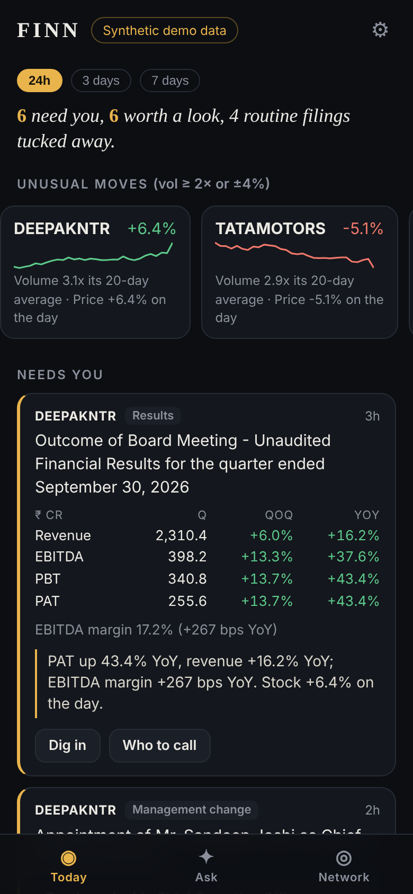
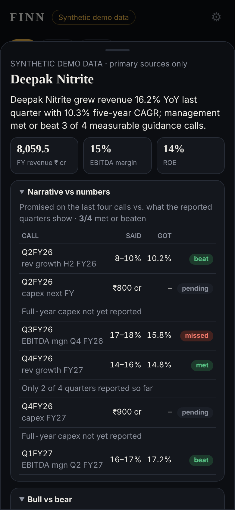
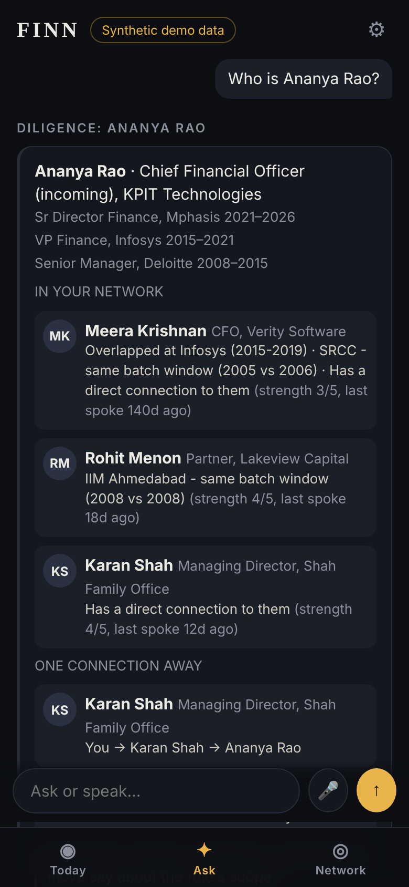
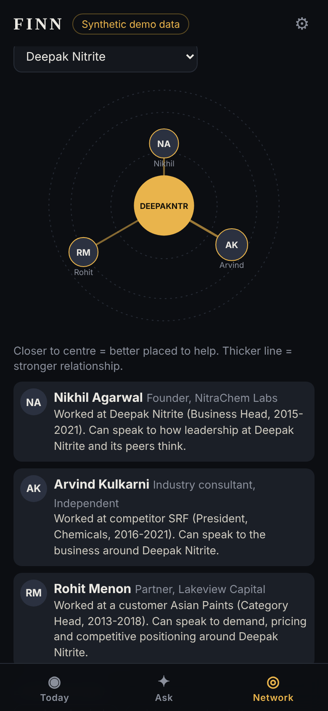

# FINN — a mobile-first investor agent (Push · Pull · Network)

Responsive web app (FastAPI + one vanilla-JS page, no build step). Open on a phone, or in a desktop browser at phone width.

```bash
pip install -r requirements.txt
uvicorn app.main:app --port 8000      # http://localhost:8000
pytest tests                          # 19 tests
# or: docker build -t finn . && docker run -p 8000:8000 finn
```

   

## Read this first: what is real and what is synthetic

The build environment had **no outbound access** to Yahoo, NSE or screener.in, so the demo runs on **synthetic data**, flagged in the UI by a "Synthetic demo data" badge:

| Layer | Demo uses | Real path (written, **untested** — could not reach the sites) |
|---|---|---|
| Prices / volume | seeded random walk with 4 planted unusual moves | `app/fetchers/yahoo.py` (yfinance, `.NS`) |
| Filings | 22 hand-written filings with realistic subjects and results tables | `app/fetchers/nse.py` |
| Fundamentals + transcripts | 4 invented companies (Asian Paints, Deepak Nitrite, KPIT, Titan) with 5y annual and 8 quarters of data plus four transcript excerpts each. **Company figures are illustrative, not the real firms' disclosures.** | `app/fetchers/screener.py` — also what makes research work on *any* ticker |
| Network | 22 fictional contacts + 3 people named in filings | profile data: see Privacy below |

Any dataset in `data/live/*.json` overrides the seed with the same schema, so running a fetcher switches that layer to live data with no code change. Treat the fetchers as a starting point: scraper markup changes, and I expect to fix selectors on first contact.

## What it does

**Push (Today tab).** Windowed digest (24h / 3d / 7d) over the portfolio. Each filing is classified (rules over the reference categories), scored (category base + position weight + parsed-results magnitude + same-day price reaction + a bonus when the Network has something to say), and tiered into *Needs you / Worth a look / routine (collapsed)*. Results filings are parsed from the exchange table into Revenue, EBITDA, PBT, PAT with QoQ and YoY (the parser reads the header dates to decide which column is which; there's a test for shuffled columns). Management changes resolve the named person to a profile (fuzzy entity-link with a confidence score), show their career, and say who in your network overlapped with them, studied with them, or is one connection away. M&A / capex / litigation show the best person to call and why. Triggered alerts (volume ≥ N× 20-day average, price move beyond ±X%) have thresholds set by sliders in Settings; "filing types I always want" chips live there too. A "keep the network warm" strip suggests reconnecting with a lapsed contact whose employer just filed.

**Pull (Ask tab → research sheet).** Primary data only (annual-report tables and notes, concall transcripts). All numbers are computed in code; nothing comes from model memory. Sections: business, financial snapshot, trajectory, balance sheet, cash quality, **narrative vs numbers**, bull/bear, annual-report flags. Narrative vs numbers extracts each explicit guidance statement from the last four calls (revenue growth, EBITDA margin, capex), works out which reported quarters it covers, computes what was actually delivered, and marks it met / beat / missed / pending (incl. "only 2 of 4 quarters reported"). Every bull/bear point carries its source.

**Network.** Not a separate app: it is called from Push cards, the research sheet, and the Ask router, and has its own tab. Scenarios: *who should I call* (worked there / competitor / supplier / customer, weighted by recency and relationship strength, with a role-aware "what they'd know"), *second-degree reach*, *diligence on people* (career, overlaps, questions worth asking such as short tenures), *expertise map* by theme, *keep warm*.

**Interaction model.** Three tabs, but the centre of gravity is Ask: a single bar (typed or voice via the browser's speech API) routed to typed cards, so "who is the new CFO?" and "dig into Titan" are the same gesture. Detail opens in bottom sheets so you never lose your place in the digest.

## Architecture & decisions

**Data pipelines.** Four fetchers write JSON files in a common schema; `store.py` is the only reader and prefers live files over seed. Linking: a filing's named person is entity-resolved against contacts and filing-people (title-stripped, `difflib` ratio ≥ 0.75, the score is surfaced); employers are matched through a normaliser (strips "Ltd/India/Pvt…") plus alias lists; people ↔ companies are linked through employment history plus a small competitor/supplier/customer map per company. Refresh in production: prices EOD cron, filings polled every few minutes in market hours, fundamentals on a results-date trigger. Seed relations (competitors etc.) are hand-written here; for real I'd derive them from the annual report's related-party/peer sections and screener's peer lists.

**Security & privacy.** The network is the most sensitive asset, so the server is stateless about the user: thresholds and preferences live in the browser's `localStorage`; nothing is written server-side except cached public data. In a real deployment: per-investor tenancy with row-level isolation, network data encrypted at rest, never used to train anything and never sent to an LLM beyond the minimum fields a prompt needs (names are not required for filing classification). Profile data: only what people publish about themselves (roles, employers, education, tenure), stored with a source and timestamp, refreshed on a schedule and deletable on request; no scraping behind logins and no platform-terms violations. For real use I'd have the investor import their *own* contacts (CSV / consented export) and enrich from licensed data providers or the person's public pages, with a retention limit and an audit log of who accessed what. **This prototype uses realistic synthetic profiles only.**

**LLMs & agents.** The model is used only where deterministic code is weak, and never to produce a number. Everything else (classification, results parsing, scoring, all arithmetic, retrieval) is code: cheap, testable, and the demo works with no API at all. Provider is set in `.env` (`LLM_PROVIDER=groq`, `GROQ_API_KEY`, `GROQ_MODEL=openai/gpt-oss-20b`; Anthropic also supported) behind one seam, `app/llm.py`, which caches every response on disk by prompt hash, counts calls/errors (`GET /api/llm`) and returns `None` on any failure so each caller falls back to rules. Four uses, all on the cheap open-weight model:
1. **Ask routing.** Keyword rules answer first (free, instant). Only if they find nothing, the model classifies the question into `{intent, ticker, person, theme}`. It never writes the answer: the same card builders run, and every field is validated against real data (unknown tickers/people are discarded).
2. **Guidance extraction.** A regex prefilter keeps only guidance-like sentences (about 5% of a transcript) and sends them numbered. The model returns sentence indices plus the numbers; code rejects any item whose numbers are not literally in that sentence, and the quoted sentence always comes from the source, never from the model. Results are merged with the rule-based extractor.
3. **Filing one-liners** for top-priority items with no explanation, capped at 6 per digest, run in parallel, cached.
4. **Research verdict**: two sentences synthesised from already-computed facts (the only step that would warrant a stronger model).
Transcript text is treated as untrusted data: the model can only select among sentences and numbers already in the source. There are no autonomous agents; I would add one only for open-ended multi-step requests ("prep me for tomorrow's meeting"). **Honesty note:** these paths are covered by tests with a faked model (including bad outputs); they have not been run against the live Groq endpoint in the build environment.

**Cloud.** One container (included Dockerfile) on any small PaaS, with scheduled fetch jobs writing to object storage / Postgres; the frontend is static files served by the same app. Free-tier friendly.

## Deliberately left out / next

Real push notifications (alerts are computed on load; production would use web-push with a worker polling thresholds), auth and multi-tenancy, a real contact importer, a graph store (the network is small enough for in-memory adjacency; Postgres + recursive CTEs before Neo4j), investor-presentation parsing, PDF annual-report table extraction (screener's standardised tables stand in), and the notes-level checks (contingent liabilities, RPTs, auditor qualifications) read from the PDF instead of the synthetic fields.

## Layout
`app/seed.py` synthetic data · `store.py` data access · `push.py` classify/parse/score/alerts · `pull.py` research + guidance scoring · `network.py` graph queries · `router.py` Ask intents · `llm.py` model seam · `fetchers/` live adapters · `static/` frontend · `tests/`.
